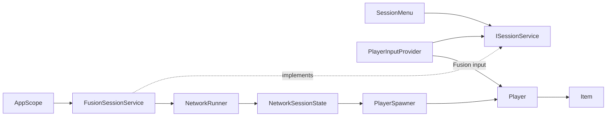

# NovaPostMP

A cooperative demo for 2-4 players using Unity 6000.3.29f1, Photon Fusion 2
(Host/Client), VContainer and the Unity Input System. Includes shared physics items,
a lobby, late joining, RTT and synchronized character colors.

## Run and controls

1. Open the `NovaPostMP` subfolder as the Unity project.
2. Open `Assets/Scenes/Bootstrap.unity`. Build a Windows player and run separate processes on one PC,
   or the same build on two PCs. The editor can replace one process. use Fusion's
   Single peer mode. Alternatively use Unity's Multiplayer Play Mode to simulate extra clients from the editor.
   Photon session discovery requires internet access.
3. Enter a display name and room name, then press **Host**. Other instances enter the
   same room name and press **Join**. The limit is four players, including the host.
4. The host presses **Start** to load Gameplay. Join the same room after Start to
   try late joining. **Leave** returns to the menu.

There are no custom command-line arguments. Connection uses a Photon room name.

| Input | Action |
| --- | --- |
| WASD / arrows | Move |
| Hold right mouse button and move mouse | Orbit camera |
| 1 | Spawn an item |
| 2 | Grab a nearby free item in front, or release the held item |
| 3 | Throw the held item |
| 4 | Delete the held item |
| Q | Change character color |
| Tab | Show/hide the in-game player list |

Bindings are in `Assets/InputSystem_Actions.inputactions`, in the Player map.

## High level architecture

`AppScope` registers settings, the singleton session service and the menu with
VContainer. The service manages runner creation, approval, scenes and cleanup, and
initializes the runner's input provider. `NetworkSessionState` owns roster/readiness.
`PlayerSpawner` manages avatars. Camera orbiting and appearance/color customization are separate components.
Gameplay tuning and the item prefab live in the serialized `GameConfig` asset.

- **Adding another item:** duplicate `ItemPrefab`, retain its Item layer and component
  references, register it with Fusion and assign it in `Assets/Configurations/GameConfig.asset`.
  The app currently handles a single generic item type so adding new ones need additional
  prefab selection logic.

## Networking decisions

- **Authority and movement:** the listen host owns session, avatar and item state;
  clients supply avatar input. `NetworkCharacterController` provides client prediction,
  authoritative correction and interpolated remote rendering. This keeps movement
  responsive while the host decides world interactions.
- **Items:** only the host spawns items, without assigning them to their creator, so
  they survive the creator's departure.
      - Grabbing checks range/availability
      - Release and throw check the holder
      - The first valid grab processed wins
      - Held items become kinematic with their collider disabled
      - Release restores physics
      - Throw adds an impulse
      - `NetworkRigidbody` synchronizes physics state
      - Held visuals follow the interpolated holder
      - `Holder` records possession without transferring Fusion authority
      - No custom item prediction is added
- **Loading and late join:** initial participants signal scene loading through
  `RPC_Loaded`. Once all remaining initial participants are ready, the host schedules
  a shared start tick one second ahead.
      - Departed players leave the barrier
      - Late joiners load independently
      - The shared tick coordinates simulation
      - Items, holders and colors are replicated for late joiners.
- **Disconnects:** 
      - Departing players/avatars are despawned
      - Items recover physics when their holder disappears
      - Host loss uses the existing shutdown path to unload Gameplay and return clients to the menu
      - There is no host migration.
- **Traffic:**
      - Movement and action buttons travel as Fusion input
      - Character and rigidbody snapshots follow the configured tick/send rates in
  `Assets/Photon/Fusion/Resources/NetworkProjectConfig.fusion`
      - Loading is signaled once per peer
      - Roster, readiness, holder and color use replicated properties
      - RTT is sampled once per second and written only when changed
      - Host RTT is zero

## Known issues and remaining work

- **Transport requirement:** the brief requires IP:port or Steam P2P entry. This demo
  uses Photon room names, Photon Fusion 2 does not have transport as an configurable option. 
  Connections are established through UDP or Photon Relay.
- **Ownership interpretation:** holding uses the replicated `Holder` reference
  explicit Fusion input-authority handover is absent.
- **Optional features:** duplicate/build-version approval, host kick and Steam features are absent.

**Windows build link** https://drive.google.com/file/d/1X09VwQZlixgaCeGvQi8A4TO65gLyirHD/view?usp=sharing
**Demo video link** https://youtu.be/xVZ-nMK6VA8
**Approximate total effort in hours**. ~30
